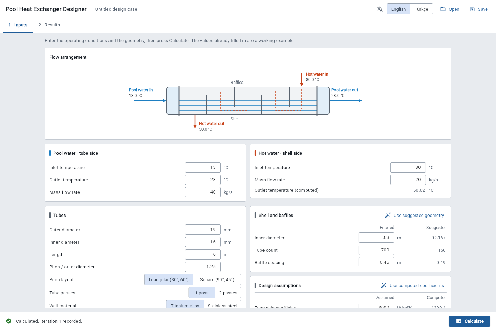
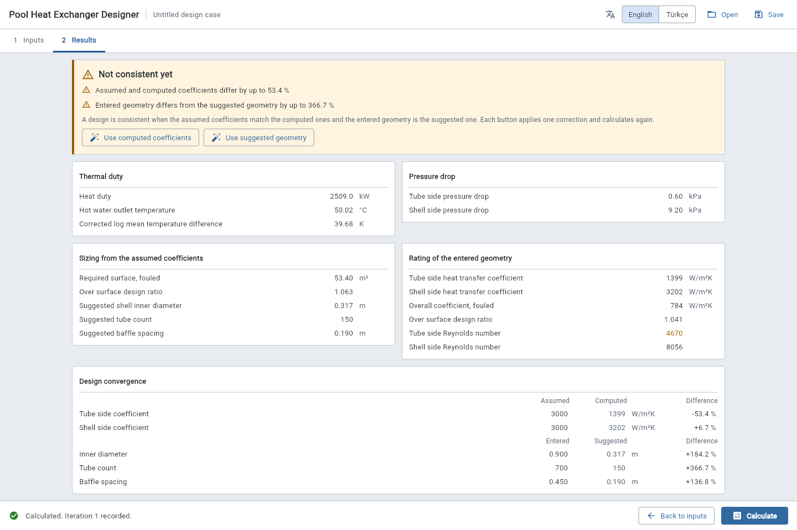

# Pool heat exchanger designer

A shell and tube heat exchanger design tool for olympic swimming pools. Water to water,
single phase, up to 6 bar. It sizes an exchanger against TEMA and FINA limits using the
correlations in Kakaç, Liu and Pramuanjaroenkij, *Heat Exchangers: Selection, Rating and
Thermal Design*.

It is a design aid, not a rating package and not a pressure vessel calculation. What it can
and cannot be trusted to do is written down in [docs/validation.md](docs/validation.md).

## What this repository is

The tool was written in 2022 as a Bilkent ME430 course project: one 925 line `main.py`, tkinter,
forty module level globals, and a README that told users to restart the program if they changed
an input after calculating. That version lives in this repository's git history, at commit
`067f66e` (`git show 067f66e:main.py`).

This is the 2026 rewrite. The physics was sound and is reproduced exactly; the engineering
around it was not. Four real defects were found and fixed, and every one is proven by a named
test that reproduces the old number on purpose before showing the new one. The whole accounting
is in [docs/validation.md](docs/validation.md#deliberate-numerical-differences-from-the-2022-implementation).

## How to start the program

Requires Python 3.12 or newer. Everything below was run on Python 3.12.10.

### 1. Install

From the repository root, in a virtual environment:

    python -m venv .venv
    .venv\Scripts\activate          # Windows
    source .venv/bin/activate       # macOS and Linux

    pip install .                        # core and command line: no third party dependencies
    pip install ".[desktop-interface]"   # adds the desktop window
    pip install ".[web-interface]"       # adds the interface served over http

There are two interface extras, not one, because Flet ships its desktop and web clients as
separate distributions and the base `flet` package contains neither. If the matching client is
missing, Flet tries to `pip install` it over the network while starting up and exits if that
fails. The extras install it ahead of time, and the program refuses with an actionable message
rather than reaching for the network.

With no interface extra installed at all, `poolhx gui` exits 2 and says:

    The graphical interface needs Flet. From the project folder, install the matching extra with
        pip install ".[desktop-interface]"
    or, to serve it over http,
        pip install ".[web-interface]"
    Import failed with: No module named 'flet'

With `flet` present but its client distribution missing, it exits 2 and names the one to add:

    GraphicalInterfaceUnavailableError: flet_desktop is not installed, and Flet would try to
    install it over the network at startup. From the project folder, install it ahead of time with
        pip install ".[desktop-interface]"

### 2. Run a design headlessly

This needs no interface extra at all:

    poolhx evaluate examples/olympic_pool_fifty_meter.toml

The first lines of output:

    Design case: olympic pool, fifty meter, titanium tubes

    THERMAL DUTY
      Heat duty                                                  2508.9600 kW
      Hot water outlet temperature                                 50.0172 °C
      Corrected log mean temperature difference                    39.6766 K

`pool-heat-exchanger-designer` is the full name of the same command; `poolhx` is a shorter alias.

### 3. Keep and compare results

    poolhx evaluate examples/olympic_pool_fifty_meter.toml --json-output-path first.json
    poolhx evaluate my_variant.toml --json-output-path second.json
    poolhx compare first.json second.json

`compare` prints every quantity that differs by more than the tolerance and exits 4; it exits 0
and says the two agree when they do. The JSON is deliberately English in any language, so that
two runs stay comparable.

### 4. Open the graphical interface

    poolhx gui                 # desktop window, needs the desktop-interface extra
    poolhx gui --web           # served over http, needs the web-interface extra

In web mode, open:

    http://127.0.0.1:8550

The server listens on `127.0.0.1` only, so nobody else on the network can reach it. To serve it to
other machines on purpose, pass `--host 0.0.0.0`; the container does exactly that, because a
process inside a container must listen on all of its interfaces for Docker to forward a port to
it, and `compose.yaml` then publishes that port on the host's `127.0.0.1` only.

The program does not print its address itself. Flet logs it, together with its own diagnostics,
when `FLET_LOG_LEVEL` is set; see [Running from source](#running-from-source-to-debug).

The web mode serves its own renderer rather than fetching it from a content delivery network, so
it works on a machine with no outbound internet access.

### 5. Choose the language

Every message the program prints or displays is available in English and Turkish:

    poolhx --language tr evaluate examples/olympic_pool_fifty_meter.toml
    poolhx --language tr gui

    Tasarım: olympic pool, fifty meter, titanium tubes

    ISIL YÜK
      Isı yükü                                                       2508.9600 kW
      Sıcak su çıkış sıcaklığı                                         50.0172 °C
      Düzeltilmiş logaritmik ortalama sıcaklık farkı                   39.6766 K

The interface has an English and Türkçe switch in its title bar; changing it retranslates the
screen and keeps whatever you have typed and whatever you have calculated.

### 6. With Docker

The image runs both the headless command and the web interface, and needs no X server.

    docker compose up designer          # interface at http://127.0.0.1:8550
    docker compose run --rm evaluate    # headless run, result written to ./results

**This image has never been built.** Docker is not installed on the machine where this rewrite
was done, so the `Dockerfile` and `compose.yaml` are written and reviewed but unproven. The
mechanisms inside them were each verified separately — `FLET_FORCE_WEB_SERVER` and the local
renderer against Flet's own source, the pinned `hatchling` version against the index, and the
`web-interface` extra by installing and serving it — but the build itself has not been run.
Treat the Docker route as untested until you have run it once.

## Using the interface

The interface has two steps, and the button for the next one is always in the bar at the bottom.

**1 Inputs.** A drawing at the top shows which water goes where: pool water through the tubes,
hot water through the shell, with the temperatures you entered. Below it, each group is one part
of the exchanger. Every row is a label, a value and a unit; a value outside its accepted range
turns red and says what range it accepts. The values already filled in are a working example,
so Calculate works straight away.



**2 Results.** Calculate opens this page. The box at the top says whether the design is
consistent, which means two things: the coefficients you assumed match the ones computed for your
geometry, and the geometry you entered is the one the sizing suggests. If not, it says by how much,
and offers one button per correction. Each button fills in the corrected values and calculates
again. Below it are the duty, the pressure drops, the sizing, the rating, the standards checks,
any correlation used outside its validated range, and the iteration history, which exports to
CSV.



Changing any input after a calculation says so in the bottom bar, so an out of date result is
never mistaken for a current one.

## How a design is specified

One design case is one TOML file that fully determines one run, including the assumed heat
transfer coefficients and the log mean temperature difference correction factor. Every key
carries its unit, and everything in the file is SI.

```toml
name = "olympic pool, fifty meter, titanium tubes"

[operating_conditions]
tube_side_inlet_temperature_celsius = 13.0
tube_side_outlet_temperature_celsius = 28.0
shell_side_inlet_temperature_celsius = 80.0
tube_side_mass_flow_rate_kilograms_per_second = 40.0
shell_side_mass_flow_rate_kilograms_per_second = 20.0

[tube]
outer_diameter_meters = 0.019
inner_diameter_meters = 0.016
length_meters = 6.0
```

See [examples/olympic_pool_fifty_meter.toml](examples/olympic_pool_fifty_meter.toml) for the
whole schema.

This is where reproducibility comes from, not from the interface: the same file and the same
version produce the same JSON, and two JSON files can be diffed by `poolhx compare`. The
interface is an editor for the file and a viewer for the result.

What is **not** claimed: bit for bit identical floating point results across operating systems,
because `**` and the other libm calls may differ in the last digit between platforms. The
container pins the interpreter and the system libraries, which is most of the way there, and
`requirements-lock.txt` pins the dependency versions.

## How the design loop works

The tool does not solve for you. You assume the two film coefficients, it sizes the exchanger
from them and separately rates the geometry you entered, and you adjust until the two agree.
That manual loop is the method, kept on purpose
([decision 0008](docs/decisions/0008-the-manual-coefficient-iteration-is-kept.md)).

A design counts as consistent only when both halves agree: the assumed coefficients match the
computed ones **and** the entered geometry is the suggested one
([decision 0020](docs/decisions/0020-a-consistent-design-needs-agreeing-coefficients-and-the-suggested-geometry.md)).
An earlier version declared convergence as soon as the coefficients matched, which one click
always achieves while the rated exchanger stays unrelated to the sized one.

What the rewrite removes is the clerical work. The interface shows assumed against computed and
entered against suggested with the gap as a percentage, one button applies each correction, and
the iteration history is recorded and exportable so the path is visible rather than remembered.

**Open question.** Applied over and over, the two corrections do not settle for the example case:
the tube count swings 150, 226, 75, 96, 53, 60, 46 while the computed coefficients climb. Nothing
in the design stops the exchanger shrinking. A tube side velocity limit or a realistic allowable
pressure drop would; which one, and its value, is an engineering decision that has not been made
yet.

## Reading the code

There are no comments and no docstrings. Intent lives in file and function names, units live in
identifier names, literature citations live in [docs/validation.md](docs/validation.md), and
every rejected alternative lives in [docs/decisions/](docs/decisions/0000-index.md). That is a
deliberate standard, with its costs stated:
[decision 0003](docs/decisions/0003-no-comments-and-no-docstrings.md) and
[decision 0004](docs/decisions/0004-units-in-identifier-names-instead-of-a-units-library.md).

    src/pool_heat_exchanger_designer/
      calculation/                         everything with no screen: physics, data, files, CLI
        design_errors.py                     the error hierarchy, used from everywhere
        properties.py                        water property table and interpolation, tube materials
        geometry.py                          how the exchanger is described, and what is possible
        tube_side_correlations.py            Gnielinski and Petukhov
        shell_side_correlations.py           the Kern method
        thermal.py                           duty, LMTD, overall coefficient, preliminary sizing
        design_evaluation.py                 the one module that knows the order of the steps
        standards.py                         TEMA and FINA limits, as reported checks
        design_case.py, design_report.py,    the files a user keeps: TOML in, text and JSON out,
        iteration_history.py                 and the CSV iteration log
        language.py, translator.py,          every user facing string, English and Turkish
        message_catalogue.py
        command_line_interface.py            argparse, the headless entry point
      user_interface/                      everything with a screen: Flet, and nothing else imports it

The first split is the one that matters: `calculation` never imports `user_interface` or Flet,
which a test enforces. The standards this code is held to, and what was deliberately left
undone, are written out in [docs/CODING_STANDARDS.md](docs/CODING_STANDARDS.md).

The calculation core imports no user interface library, which is why a single correlation can
be tested without constructing a window
([decision 0005](docs/decisions/0005-the-calculation-core-has-no-user-interface-dependency.md)).

## Development

On Windows, one script does everything; the first use creates `.venv` and installs the project
([decision 0022](docs/decisions/0022-a-root-run-script-gives-npm-style-commands.md)):

    run dev              # serve the interface in the browser, Flet's log in the terminal
    run test             # pytest
    run check            # the whole gate: pytest, ruff check, ruff format --check, mypy
    run build            # wheel and sdist into dist/
    run build windows    # the Windows desktop app, through flet build
    run desktop          # start the built desktop app, its Python log streaming in the terminal

Typing plain `run` works through a small `run` function in the owner's PowerShell profile that
calls `.\run.ps1` (or `npm run` where there is a `package.json` instead); without the profile
function, type `.\run <task>`. `run build linux` and `run build mac` refuse on this machine,
because Flet builds a platform's app only on that platform.

`run build windows` has been run to completion on this machine: it produces
`build/windows/pool-heat-exchanger-designer.exe` (about 90 MB with the bundled runtimes). The
build needs Windows Developer Mode (for symlinks) and the C++ side of Visual Studio Build Tools
(MSVC, CMake tools, a Windows SDK); on a machine without them, Flutter's doctor report names
exactly what is missing.

Each build is testable by hand. The desktop app: `run desktop` starts the built executable and
streams its Python log (the packaged app's `console.log`) into the terminal, so a traceback in
the packaged app is read in the terminal rather than squinted at in the window. The wheel:
install `dist/pool_heat_exchanger_designer-*.whl` into a fresh virtual environment and run
`poolhx evaluate examples/olympic_pool_fifty_meter.toml` from any folder.

The same thing by hand, on any platform:

    pip install ".[desktop-interface,web-interface]"
    pip install pytest ruff mypy
    pytest
    ruff check .
    ruff format --check .
    mypy

The development tools are also declared as a PEP 735 dependency group in `pyproject.toml`, so a
tool that understands dependency groups, such as `uv sync --group development`, can install them
in one step. That route has not been run here, because `uv` is not installed on the machine this
was written on; the two `pip install` lines above have.

### Running from source, to debug

Without installing the project, from the repository root, in a Python that has the dependencies:

    $env:PYTHONPATH = "src"              # PowerShell; in bash: export PYTHONPATH=src
    $env:FLET_LOG_LEVEL = "info"         # Flet's own log, including the address it serves on
    python -m pool_heat_exchanger_designer gui
    python -m pool_heat_exchanger_designer gui --web

Every Python traceback lands in that terminal. `debug` instead of `info` shows more.

Physically impossible input raises; a standards violation is reported and the calculation
continues. That distinction is deliberate
([decision 0007](docs/decisions/0007-impossible-geometry-raises-but-a-standards-violation-is-reported.md)).

## Criticism welcome

Several choices here are arguable, and the records say which. The
titanium thermal conductivity and both fouling resistances are the author's inputs rather than
derived values and are flagged for checking in
[docs/validation.md](docs/validation.md#constants-that-the-author-chose-rather-than-derived);
and the correction factor sitting at 0.9 is an assumption, not a result. If you can do any of
it better, open an issue.

## Authors

Hami Bahadır Bilir and Yunus Özkan. Bilkent University ME430 Heat Exchangers and Design,
instructor Dr. Barbaros Çetin. The original course report is
[docs/HeatExchangerDesign.pptx](docs/HeatExchangerDesign.pptx).
